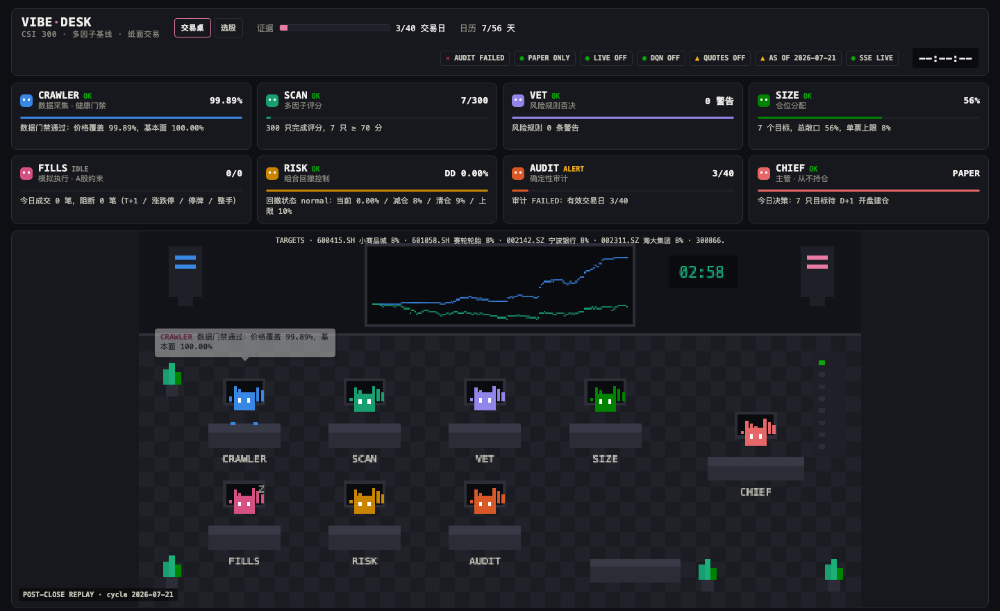
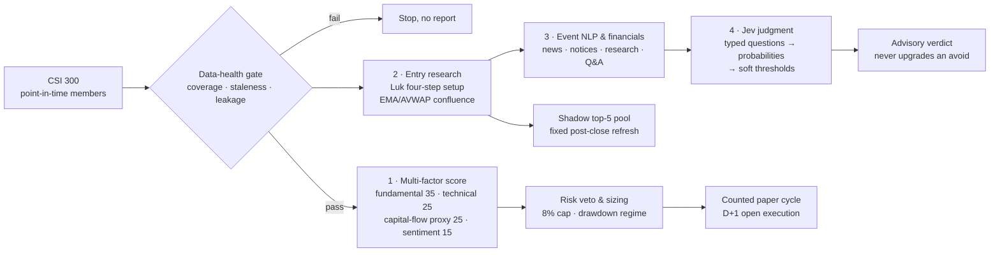
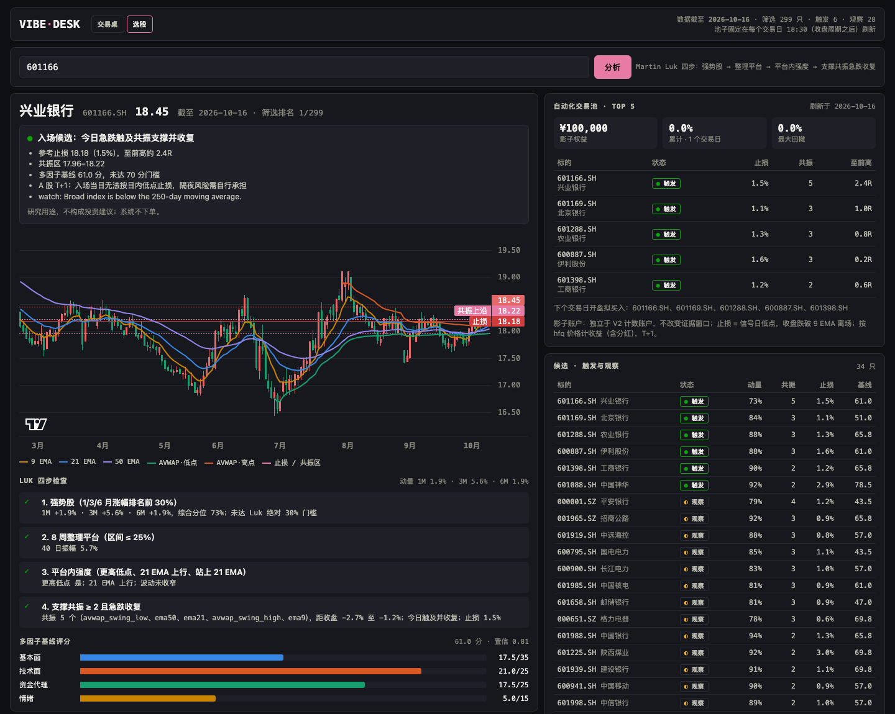
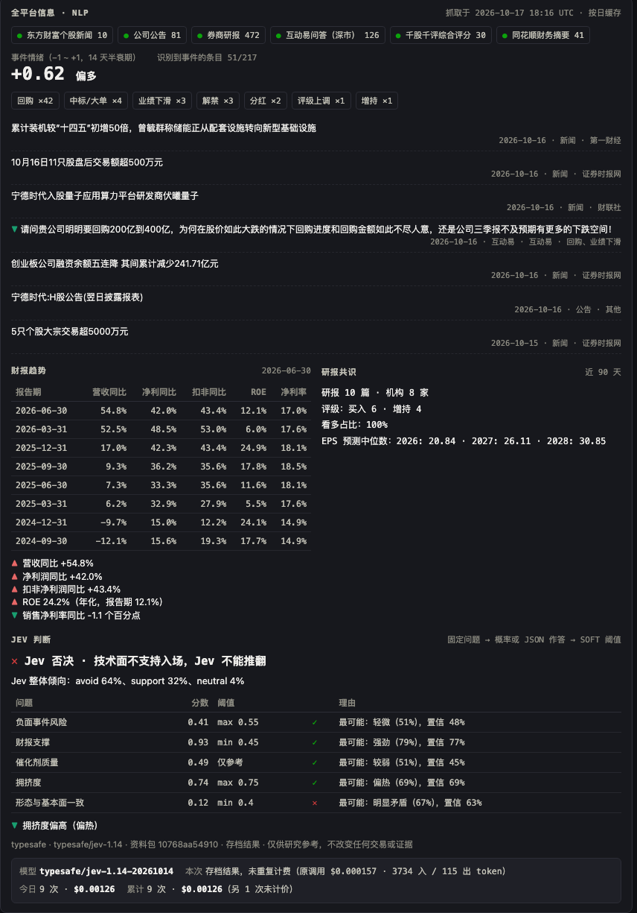
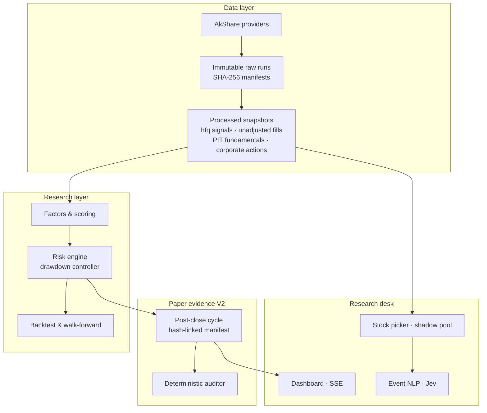

<div align="center">

# Vibe-Trading

**A point-in-time, audit-first quantitative research desk for China A-shares (CSI 300)**

Multi-factor stock selection · Martin Luk–style entry research · event NLP · Jev decision-model judgment · fail-closed paper-trading evidence


[English](README.md) · [中文](README_zh.md)

</div>



## Overview

Vibe-Trading is a research system, not a trading bot. Every step from raw data to a daily decision
is reproducible from immutable, hash-verified inputs and a known commit, and every gate fails closed:
missing data, stale factors, broken hash chains or session gaps stop the pipeline rather than
producing a report. Live brokerage is deliberately out of scope until a paper-trading evidence window
passes fixed gates.

**Highlights**

- **Point-in-time CSI 300 universe.** Historical membership is rebuilt from an official anchor plus
  186 adjustment pairs (439 stocks, 461 membership intervals, exactly 300 members on every checked
  date), so backtests never use today's constituents in the past.
- **Four-layer stock selection.** Multi-factor scoring, momentum-base entry research, rule-based
  event NLP with financial-trend analysis, and a decision-model "Jev" judgment with soft thresholds.
- **Realistic A-share execution.** T+1, limit-up/limit-down blocking, suspensions, board lots, CNY 5
  minimum commission, date-specific stamp duty, slippage, FIFO dividend tax and a 2,452-event
  corporate-action ledger; signals use hfq prices, fills use unadjusted prices at the next open.
- **Evidence chain.** Each post-close cycle writes a schema-v2 manifest hash-linked to its parent; a
  deterministic auditor checks account continuity, costs, NAV, drawdown and benchmark excess.
- **Live research desk.** A zero-dependency HTTP + SSE dashboard with agent cards, a pixel-office
  view, a stock picker that searches any of 5,500+ A-shares on demand (CSI 300 members use the
  point-in-time panel; others are fetched live and labelled as such), shadow pools and per-call model
  cost tracking.

## Results

Formal point-in-time backtest, CSI 300, 2021-06-15 → 2026-07-13, CNY 100,000 start, all modeled
costs and individual dividend tax included.

| Strategy | Total return | Annualized | Max drawdown | Sharpe | Trades |
| --- | ---: | ---: | ---: | ---: | ---: |
| **Risk-controlled multi-factor baseline** | **+118.3%** | **17.3%** | **9.65%** | **1.71** | 4,336 |
| Unrestricted multi-factor baseline | +115.3% | 17.0% | 12.21% | 1.72 | 4,481 |
| CSI 300 index | −9.1% | — | 39.84% | — | — |

Excess return over CSI 300 is positive in all four walk-forward segments
(+27.7%, +19.0%, +26.6%, +20.7%). The 8% / 9% / 10% drawdown controller is what keeps the
risk-controlled variant inside the 10% drawdown target.

**Restatement (2026-10-18):** an [attribution review](docs/research/2026-10-18-backtest-attribution.md) found that the backtest's broad-market risk rule uses each day's close to trade at that day's open, a same-day look-ahead. The figures above are therefore not evidence of skill: the dividend-inclusive CSI 300 returned +3.7%, not −9.1%, and on the strategy's own exposure path stock selection lagged the index.

Shadow top-5 momentum pool (untuned replay on point-in-time membership, 2024-01-02 → 2026-10-16):
+36.0% vs CSI 300 +23.2%, but 22.3% maximum drawdown, so it stays a shadow book and never drives the
counted strategy.

> Historical results are research evidence, not proof of future profit. A fresh paper-trading
> evidence epoch was anchored on 2026-10-16; at least 40 sessions over 56 calendar days must pass the
> auditor before any review.

## Stock selection pipeline



| Layer | What it does | Implementation |
| --- | --- | --- |
| Multi-factor | 35/25/25/15 score with a 70-point / 0.8-confidence entry gate; drives the counted paper account | `research/scoring.py`, `risk/`, `backtesting/drawdown_control.py` |
| Entry research | Momentum leader → 8-week base → strength inside the base → flush into ≥2 confluent supports and reclaim; stop at the day's low | `research/momentum_setup.py` |
| Event NLP | Six sources per stock, clause-level negation, filing/news/Q&A weighting, 14-day half-life; annualized ROE and growth trends | `information/stock_intel.py`, `information/event_nlp.py` |
| Jev judgment | TypeSafe Jev answers five typed questions with probabilities (DeepSeek as a chat fallback); deterministic thresholds give support / neutral / veto; every call is recorded with model, hashes and cost | `research/jev.py` |

<table>
<tr>
<td width="62%"></td>
<td width="38%"></td>
</tr>
<tr>
<td align="center">Stock picker: search, Luk checklist, confluence zone and stop, shadow pool</td>
<td align="center">Six-source research, event NLP, financial trend and Jev verdict with cost</td>
</tr>
</table>

## Architecture



## Research integrity

- Raw downloads are immutable; every rebuilt artifact records its parent manifest hash, request,
  coverage and commit. Failed scopes resume as new `-retry-N` runs instead of overwriting.
- Fundamentals join on public disclosure date; benchmark data never enters stock-selection features.
- Coverage, variation and staleness are checked for every score component; a constant or stale
  component fails the run.
- Suspended members are accepted only when two independent price sources agree, and are never scored.
- RL (DQN) is diagnostic only: the Torch and linear backends disagree, so neither may raise exposure.
- LLM output is advisory and recorded verbatim; it is never backtested (look-ahead bias) and never
  touches the counted strategy or the evidence chain.

## Tech stack

| Area | Tools |
| --- | --- |
| Language & tests | Python 3.14 standard library core, pytest (540 tests), ruff |
| Data | AkShare (Sina, Tencent, Eastmoney, CNInfo, Tonghuashun endpoints), Tushare adapter |
| Research | pandas / NumPy for research extras, custom point-in-time joins and manifest chain |
| ML | PyTorch DQN and linear fitted-Q (diagnostic only), Gymnasium |
| LLM & decisions | TypeSafe Jev via OpenRouter decisions API, DeepSeek (OpenAI-compatible), Anthropic |
| Web | `http.server` + Server-Sent Events, Canvas pixel art, TradingView Lightweight Charts, Chart.js |

## Quick start

```bash
python3.14 -m venv .venv && source .venv/bin/activate
pip install pytest akshare pandas numpy matplotlib truststore
python -m pytest -q        # code runs from src/, no package install needed
```

```bash
python scripts/serve_trading_desk.py          # desk at http://127.0.0.1:8765, picker at /picks
```

```bash
python scripts/refresh_momentum_pool.py       # shadow pool, once per closed session
python scripts/refresh_momentum_pool_v2.py    # shadow pool v2, after the v1 refresh
```

Optional model keys go in a git-ignored `.env`: `JEV_MODEL=Jev 1.14` with `OPENROUTER_API_KEY`
for TypeSafe Jev, or `DEEPSEEK_API_KEY` for DeepSeek. The full daily pipeline (membership,
factors, post-close cycle, audit, epoch bridge) is documented in
[docs/operations.md](docs/operations.md).

## Repository layout

```text
src/fintech_quant/
  data/          providers, point-in-time membership, immutable manifest chain
  features/      technical, fundamental and capital-flow factors
  research/      scoring, data health, momentum setup, shadow pool, Jev
  information/   multi-source stock intel, event NLP, financial reports
  risk/          layered risk rules (single stock, broad market, systemic, portfolio drawdown)
  backtesting/   A-share costs and constraints, corporate actions, dividend tax, drawdown control
  execution/     A-share paper account, evidence chain, human execution ledger
  training/      DQN, fitted-Q and walk-forward evaluation (diagnostic)
  reports/       dashboards, picker, PnL curve, pre-market brief
scripts/         command-line entry points
tests/           540 tests across data, research, execution and reports
docs/            operations guide, research notes, design specs
```

## Roadmap

- [x] Point-in-time CSI 300 data, formal backtest and drawdown control
- [x] Hash-chained paper-evidence V2 with deterministic audit
- [x] Research desk, stock picker, shadow pool, event NLP and Jev judgment
- [x] Cross-sectional factor lab: 27 neutralized factors, IC/quintile metrics, locked hold-out
- [x] Scoring v2 research score: rank composite with ICIR category weights, shown in the picker
- [ ] Costed backtest of scoring v2 before it can be proposed for a future evidence epoch
- [ ] Accumulate 40 counted paper sessions over 56 calendar days
- [ ] LLM-assisted extraction from full announcement and report text
- [ ] Independent replay audit of tax lots and corporate actions
- [ ] CSI 800 generalization study

## Documentation

- [Operations guide](docs/operations.md): every command and pipeline stage
- [Martin Luk setup on A-shares](docs/research/2026-10-17-martin-luk-momentum-setup.md): method, replay and limits
- [Factor lab](docs/research/2026-10-19-factor-lab.md): IC, quintiles and combined signals with a locked hold-out
- [Scoring v2](docs/research/2026-10-20-scoring-v2.md): predeclared rank composite against the counted score
- [AI trading desk teardown](docs/research/2026-10-17-ai-trading-desk-teardown.md): design references and roadmap
- [Project contract](AGENTS.md) and [handoff](handoff.md): research rules and current operational state

## Disclaimer

For research and education only. Nothing here is investment advice. The system never connects to a
broker or places orders, and historical or paper results do not guarantee future returns.
