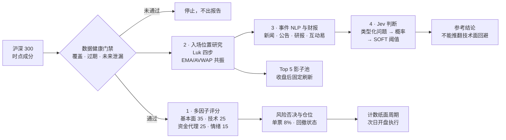
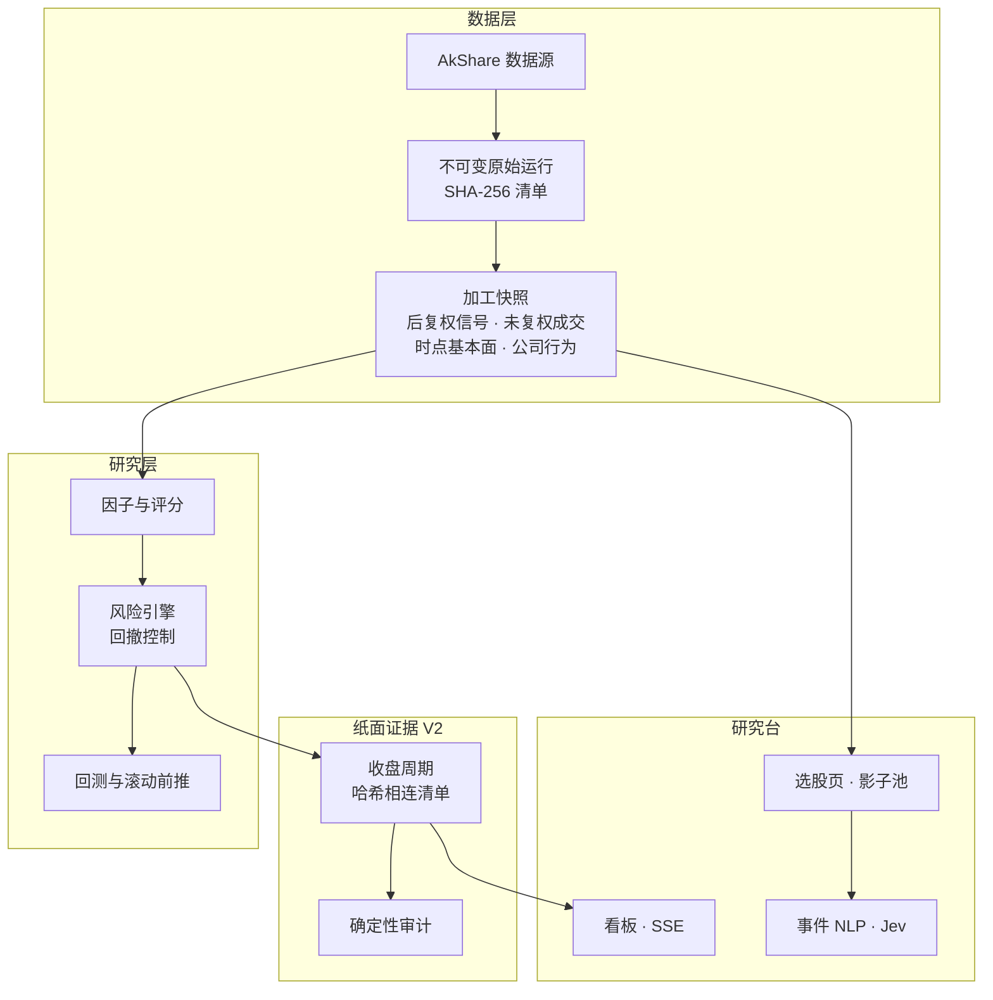

<div align="center">

# Vibe-Trading

**面向 A 股（沪深 300）的时点一致、可审计的量化研究交易台**

多因子选股 · Martin Luk 式入场位置研究 · 事件 NLP · Jev 决策模型判断 · 失败即停的纸面交易证据链


[English](README.md) · [中文](README_zh.md)

</div>


## 项目概览

Vibe-Trading 是研究系统，不是自动交易机器人。从原始数据到每日决策，每一步都能用不可变、
带哈希校验的输入和已知代码版本复现；所有门禁失败即停：数据缺失、因子过期、哈希链断裂或交易日
缺口都会让流水线停下，而不是照常出报告。在纸面交易证据窗口通过固定门禁之前，刻意不接入实盘券商。

**亮点**

- **时点一致的沪深 300 成分。** 以官方锚点加 186 组调整记录重建历史成分（439 只股票、
  461 个成分区间，每个检查日恰好 300 只），回测绝不把今天的成分用到过去。
- **四层选股。** 多因子评分、强势平台入场研究、规则化事件 NLP 与财报趋势、Jev 决策模型判断加
  SOFT 阈值。
- **贴近真实的 A 股执行。** T+1、涨跌停阻断、停牌、整手、5 元最低佣金、分日期印花税、滑点、
  先进先出股息税，以及 2,452 条公司行为台账；信号用后复权价，成交用未复权价并在次日开盘执行。
- **证据链。** 每个收盘周期写出与上一周期哈希相连的 V2 清单；确定性审计校验账户连续性、成本、
  净值、回撤和相对基准超额。
- **实时研究台。** 零第三方依赖的 HTTP + SSE 看板：代理卡片、像素办公室、可按需搜索全部 5,500 多只 A 股的选股页（沪深 300 成分走时点数据，其余实时抓取并明确标注）、
  Top 5 影子交易池，以及每次模型调用的费用统计。

## 成果

正式时点一致回测覆盖沪深 300，区间为 2021-06-15 至 2026-07-13。初始资金 10 万元，含全部建模成本与个人
股息税。信号取 T 日收盘，T+1 开盘成交。风控判断与仓位计算只使用信号日收盘时已知的数据，
[修复](docs/research/2026-10-29-lag-fix-rerun.md)见提交 `5514a28`。

| 序列 | 总收益 | 年化 | 最大回撤 | Sharpe | 交易笔数 |
| --- | ---: | ---: | ---: | ---: | ---: |
| 风控版多因子基线 | −17.0% | −3.8% | 17.3% | −1.09 | 1,460 |
| 无风控多因子基线 | −34.4% | −8.3% | 39.5% | −0.78 | 4,244 |
| 沪深 300 全收益（H00300） | +3.7% | 0.7% | 35.8% | 0.13 | — |
| 沪深 300 价格指数 | −9.1% | −1.9% | 39.8% | −0.02 | — |

**基线没有被证明的超额能力。** 项目自己的审计发现，旧回测的大盘风控规则会先读到当天收盘，
再在当天开盘交易，因此旧结果（+118%，Sharpe 1.71）已撤回。[归因复核](docs/research/2026-10-18-backtest-attribution.md)
量化了这一泄漏：只看前一日收盘的规则不可能避开 489 个下跌日中的 487 个，旧回测却做到了
（择时 t = 11.7）。复核还把基准改为全收益指数。修复泄漏、策略不变后：

- 在相同仓位路径上，选股比指数少 15 个百分点。
- 换手 55.6 倍，成本占资金 10%。
- 回撤控制在 2023 年清仓后再未入场。

收盘决策、同一收盘成交的对照（不可能看到未来）得出同样结论。

Top 5 动量影子池（按时点成分、未调参回放，2024-01-02 至 2026-10-16）：+36.0%，同期沪深 300
+23.2%，但最大回撤 22.3%，因此只作为影子账户，不驱动计数策略。

> 历史结果是研究证据，不代表未来收益。新的纸面交易证据周期已于 2026-10-16 建立锚点，需在至少
> 56 个自然日内累计 40 个通过审计的交易日后才进入人工复核。

## 选股流程



| 层 | 作用 | 实现 |
| --- | --- | --- |
| 多因子 | 35/25/25/15 评分，70 分 / 0.8 置信度入场门槛；驱动计数纸面账户 | `research/scoring.py`、`risk/`、`backtesting/drawdown_control.py` |
| 入场研究 | 强势股 → 8 周整理平台 → 平台内强度 → 急跌至 ≥2 个共振支撑后收复；止损设在当日低点 | `research/momentum_setup.py` |
| 事件 NLP | 每只股票 6 个信息源，分句否定、公告/新闻/问答分权、14 天半衰期；年化 ROE 与增长趋势 | `information/stock_intel.py`、`information/event_nlp.py` |
| Jev 判断 | TypeSafe Jev 以概率回答 5 道类型化问题（DeepSeek 作为对话模型备选）；确定性阈值得出支持 / 中性 / 否决；每次调用记录模型、哈希与费用 | `research/jev.py` |

<table>
<tr>
<td width="62%"></td>
<td width="38%"></td>
</tr>
<tr>
<td align="center">选股页：搜索、Luk 四步检查、共振区与止损、影子交易池</td>
<td align="center">六源信息、事件 NLP、财报趋势与带费用的 Jev 判断</td>
</tr>
</table>

## 系统架构



## 研究纪律

- 原始下载不可变；每个重建产物记录父清单哈希、请求参数、覆盖率和代码版本。失败范围以新的
  `-retry-N` 运行续跑，绝不覆盖。
- 基本面按公开披露日关联；基准数据不进入选股特征。
- 每个评分分量都检查覆盖率、变化和过期；分量恒定或过期即判定运行失败。
- 停牌成分股只有在两个独立价格源一致确认时才被接受，且不参与评分。
- 回测按自身仓位路径做归因审计。审计发现风控层的当日前视泄漏，已修复并加回归测试；旧结果直接撤回，未做调参美化。
- 强化学习（DQN）仅作诊断：Torch 与线性后端行为不一致，任何一方都不得提高仓位。
- 大模型输出只作参考并原样存档；不做回测（存在前视偏差），也不触碰计数策略和证据链。

## 技术栈

| 领域 | 工具 |
| --- | --- |
| 语言与测试 | Python 3.14 标准库为核心，pytest（540 个测试），ruff |
| 数据 | AkShare（新浪、腾讯、东方财富、巨潮、同花顺接口），Tushare 适配器 |
| 研究 | pandas / NumPy（研究扩展），自研时点关联与清单链 |
| 机器学习 | PyTorch DQN 与线性拟合 Q（仅诊断），Gymnasium |
| 大模型与决策 | TypeSafe Jev（OpenRouter decisions 接口）、DeepSeek（OpenAI 兼容）、Anthropic |
| 前端 | `http.server` + Server-Sent Events、Canvas 像素画、TradingView Lightweight Charts、Chart.js |

## 快速开始

```bash
python3.14 -m venv .venv && source .venv/bin/activate
pip install pytest akshare pandas numpy matplotlib truststore
python -m pytest -q        # 代码直接从 src/ 运行，无需安装成包
```

```bash
python scripts/serve_trading_desk.py          # 交易台 http://127.0.0.1:8765，选股页 /picks
```

```bash
python scripts/refresh_momentum_pool.py       # 影子交易池，每个收盘交易日刷新一次
```

模型密钥写在被 git 忽略的 `.env` 中：TypeSafe Jev 用 `JEV_MODEL=Jev 1.14` 加 `OPENROUTER_API_KEY`，
DeepSeek 用 `DEEPSEEK_API_KEY`。完整的每日流程（成分、因子、收盘周期、审计、证据周期衔接）见
[docs/operations.md](docs/operations.md)。

## 目录结构

```text
src/fintech_quant/
  data/          数据源、时点成分、不可变清单链
  features/      技术、基本面与资金流因子
  research/      评分、数据健康、动量平台、影子池、Jev
  information/   多源个股信息、事件 NLP、财报
  risk/          分层风险规则（个股、大盘异常、系统性、组合回撤）
  backtesting/   A 股成本与约束、公司行为、股息税、回撤控制
  execution/     A 股纸面账户、证据链、人工执行台账
  training/      DQN、拟合 Q 与滚动前推评估（诊断）
  reports/       看板、选股页、收益曲线、盘前简报
scripts/         命令行入口
tests/           覆盖数据、研究、执行与报告的 540 个测试
docs/            运行手册、研究笔记、设计文档
```

## 路线图

- [x] 时点一致的沪深 300 数据、正式回测与回撤控制
- [x] 哈希相连的纸面证据 V2 与确定性审计
- [x] 研究台、选股页、影子池、事件 NLP 与 Jev 判断
- [ ] 在 56 个自然日内累计 40 个计数纸面交易日
- [ ] 用大模型从公告与财报全文中抽取结构化信息
- [ ] 股息税批次与公司行为的独立重放审计
- [ ] 中证 800 泛化研究

## 文档

- [运行手册](docs/operations.md)：所有命令与流水线阶段
- [Martin Luk 方法在 A 股的改写](docs/research/2026-10-17-martin-luk-momentum-setup.md)：方法、回放与局限
- [AI 交易台拆解](docs/research/2026-10-17-ai-trading-desk-teardown.md)：设计参考与路线图
- [项目约定](AGENTS.md) 与 [交接文档](handoff.md)：研究规则与当前运营状态

## 免责声明

仅用于研究与学习，不构成任何投资建议。系统不连接券商、不下单；历史与纸面结果不代表未来收益。
